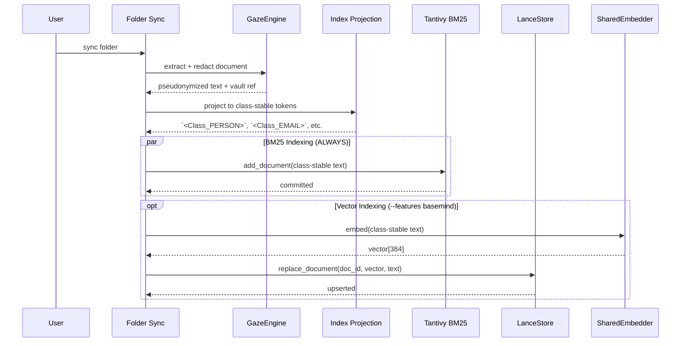
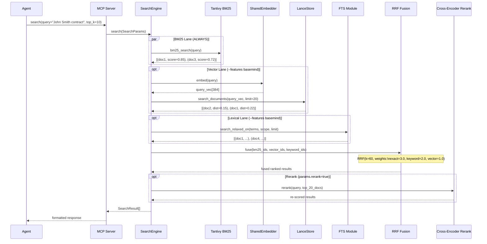

# Hacienda-Backend Architecture (Epic 14: Hybrid Search)

**Status:** This document describes the production end-to-end target and separately identifies the shipped scaffold. ADR-0005 HumanDisclosure sidecar/viewer remains **Proposed**, not shipped.
The current raw MCP/owner-fallback/fixed-key/stdout path is noncompliant and remains a release-blocking gap. Diagrams and target descriptions below must not be read as claims of implemented behavior.

## Target Contract (production)

The production boundary is a **stateful proxy/gateway**, not a transparent MITM. It owns authenticated session state, tenant/policy context, transcript sequencing, and lifecycle metadata while routing clients to the backend. It may adapt protocols, but it must never become a raw-value escape hatch or receive restore material merely because it proxies traffic.

The authoritative transcript is **token-only**: every persisted or replayable request, response, event, error, and audit-derived transcript entry contains class-stable tokens and allowlisted metadata only. Raw PII, reversible tokens, vault maps, snapshots, manifests, raw queries, and raw errors are excluded. MCP is likewise **token-only**; no MCP tool, resource, prompt, log, or error may return or persist a raw value. An egress validator is the final fail-closed check at every agent/client-facing boundary and rejects any disallowed value before delivery or durable write.

Gaze is the exclusive ingestion/redaction boundary for documents and other content entering the system. The target writes durable, fingerprint-bound token indexes (BM25 and optional vector/lexical indexes), with rebuild/checkpoint/retention semantics; in-memory indexes are only caches. HumanDisclosure is a separate owner-authenticated sidecar and isolated viewer for approved human disclosure, never an MCP response path. Claude Code, Codex, CLI, and other supported clients must receive equivalent token-only semantics and security guarantees; the optional TypeScript extension is not a recovery path.

### Target versus shipped implementation

| Area | Production target | Shipped scaffold / current gap |
|---|---|---|
| Boundary | Stateful proxy/gateway with session, tenant, policy, transcript, and egress enforcement | Direct Rust MCP over stdio/HTTP; no production stateful gateway |
| Transcript | Durable authoritative token-only transcript | No authoritative durable token-only transcript |
| MCP and egress | Token-only MCP plus final egress validator | `rehydrate` exists; raw-capable paths and no complete egress validator |
| Ingestion and indexes | Gaze-only ingestion and durable fingerprint-bound indexes | Gaze/index projection exists; folder sync and index persistence/rebuild are incomplete |
| Human disclosure | HumanDisclosure sidecar/viewer with independent owner/user-presence approval | Not shipped; owner fallback and stdout remain |
| Clients | Parity across Claude Code, Codex, CLI, and supported adapters | Direct clients work only through existing transports; parity is unverified |

## Explicit non-goals

- A transparent MITM, traffic inspection layer, or proxy that can see restore material.
- Raw PII in MCP, transcripts, logs, indexes, query/error payloads, or agent-visible storage.
- Agent-initiated rehydration, implicit owner fallback, unattended approval, or `--yes` disclosure.
- Treating the manifest, an in-memory index, or an adapter/client as authoritative custody or recovery.
- Making the TypeScript extension a required security or recovery boundary.

## System Overview

```mermaid
graph TB
    %% ============ USER / AGENT LAYER ============
    subgraph "Agent / User"
        Agent["🤖 AI Agent (Claude, etc.)"]
        CLI["💻 CLI User"]
    end

    %% ============ MCP INTERFACE ============
    subgraph "MCP Interface"
        MCPServer["🔌 MCP Server (stdio/HTTP)"]
        Tools["🛠️ MCP Tools (closed manifest)\n- search\n- sync\n- status\n- attach_local_doc\n- request_human_disclosure\n- disclosure_status\n- graph_entities (optional, feature-gated)\n- graph_rag (optional, feature-gated)\n(opaque handle/status only; no rehydrate; doctor is CLI-only)"]
    end

    %% ============ HACIENDA-BACKEND CORE ============
    subgraph "Hacienda-Backend Core"
        direction TB
        
        SearchEngine["🔍 SearchEngine"]
        BM25["📚 BM25 (Tantivy)\nALWAYS ON"]
        Vector["🧠 Vector Search\n(basemind LanceStore)"]
        Lexical["📝 Lexical Search\n(basemind FTS)"]
        RRF["⚖️ RRF Fusion\n(basemind or builtin)"]
        Rerank["🎯 Cross-Encoder Rerank\n(ort + bge-reranker-v2-m3)"]
        TierFilter["🛡️ Tier Filter\n(SensitivityTier)"]
        Projection["📋 Index Projection\n(Class-stable tokens)"]
        
        SearchEngine --> BM25
        SearchEngine -.->|feature=basemind| Vector
        SearchEngine -.->|feature=basemind| Lexical
        SearchEngine --> RRF
        SearchEngine --> Rerank
        SearchEngine --> TierFilter
        SearchEngine --> Projection
        
        BM25 --> RRF
        Vector --> RRF
        Lexical --> RRF
        RRF --> Rerank
        Rerank --> TierFilter
    end

    %% ============ GAZE (PII PSEUDONYMIZATION) ============
    subgraph "Gaze (PII Engine)"
        GazeEngine["🛡️ GazeEngine"]
        Redactor["🔒 Redactor"]
        Recognizers["🔍 Recognizers\n(Regex + NER + Dictionary)"]
        Assembly["⚙️ Assembly\n(Rulepacks)"]
        Vault["🗝️ Owner Vault\n(Manifest + Snapshot/Session\n+ TokenReplace Map)"]
        
        GazeEngine --> Redactor
        Redactor --> Recognizers
        Recognizers --> Assembly
        Redactor --> Vault
    end

    %% ============ BASEMIND (AGENT CONTEXT) ============
    subgraph "Basemind (Agent Context Layer)"
        direction TB
        LanceStore["💾 LanceStore\n(LanceDB)"]
        DocumentsTable["📄 documents table"]
        MemoryTable["🧠 memory table"]
        FTS["🔤 FTS Module\n(search_relaxed_on)"]
        Embeddings["🧮 SharedEmbedder\n(bge-small-en-v1.5)"]
        RRFModule["⚖️ RRF Module\n(rrf_fuse_detailed)"]
        Reranker["🎯 Reranker\n(liter-llm + bge-reranker)"]
        
        LanceStore --> DocumentsTable
        LanceStore --> MemoryTable
        LanceStore --> FTS
        Embeddings --> LanceStore
        RRFModule --> LanceStore
        Reranker --> LanceStore
    end

    %% ============ XBERG (DOCUMENT INTELLIGENCE) ============
    subgraph "Xberg 1.3.10 (Patched)"
        XbergCore["📄 Xberg Core"]
        Extractors["📥 Extractors\n(PDF, Office, HTML, etc.)"]
        EmbeddingsX["🧮 Embeddings\n(ONNX Runtime)"]
        RerankX["🎯 Reranker\n(liter-llm)"]
        RedactionX["🔒 Redaction\n(TokenReplace minting)"]
        
        XbergCore --> Extractors
        XbergCore --> EmbeddingsX
        XbergCore --> RerankX
        XbergCore --> RedactionX
    end

    %% ============ STORAGE ============
    subgraph "Storage"
        TantivyIdx["📚 Tantivy Index\n(In-RAM BM25)"]
        LanceDB["💾 LanceDB\n(~/.local/share/hacienda/lance)"]
        VaultFile["🗝️ Owner Vault Files\n(Encrypted; Keychain custody)"]
        ConfigFile["⚙️ basemind.toml"]
    end

    %% ============ CONNECTIONS ============
    Agent --> MCPServer
    CLI --> MCPServer
    MCPServer --> Tools
    Tools --> SearchEngine
    Tools --> GazeEngine
    Tools --> LanceStore
    
    %% Indexing flow
    SearchEngine -->|index_document| BM25
    SearchEngine -.->|index_document| LanceStore
    GazeEngine -->|exclusive detect + redact ingress| SearchEngine
    GazeEngine -.->|no raw bypass| Projection
    
    %% Search flow
    SearchEngine -->|query| BM25
    SearchEngine -.->|query embedding| Embeddings
    Embeddings --> LanceStore
    SearchEngine -.->|lexical query| FTS
    FTS --> DocumentsTable
    
    %% Storage connections
    BM25 --> TantivyIdx
    LanceStore --> LanceDB
    Vault -->|encrypted, atomically fingerprint-bound restore material| VaultFile
    SearchEngine --> ConfigFile
    
    %% Xberg integration
    XbergCore -.->|provides| Extractors
    XbergCore -.->|provides| EmbeddingsX
    XbergCore -.->|provides| RerankX
    Basemind -.->|uses| XbergCore
    
    %% Gaze integration
    GazeEngine -.->|uses| XbergCore
```



## Data Flow Diagrams

### 1. Document Ingestion Flow


### 2. Hybrid Search Flow


### 3. PII Protection Flow (Gaze Integration)
```mermaid
sequenceDiagram
    participant Doc as Raw Document
    participant Gaze as GazeEngine
    participant Redact as Redactor
    participant Vault as Vault
    participant Proj as Projection
    participant Index as Search Index

    Doc->>Gaze: "John Smith (john@acme.com) signed contract #12345" (exclusive ingress)
    Gaze->>Redact: detect PII
    Redact-->>Gaze: [PERSON:"John Smith", EMAIL:"john@acme.com", CONTRACT:"#12345"]
    
    Redact->>Vault: atomically encrypt snapshot/session + TokenReplace map
    Note over Vault: Manifest is provenance-only; all restore material shares document/content/tenant/engine-era/policy fingerprint
    Vault-->>Redact: <PERSON_1>, <EMAIL_1>, <CONTRACT_1>
    
    Redact-->>Gaze: "<PERSON_1> (<EMAIL_1>) signed <CONTRACT_1>"
    Gaze-->>Proj: pseudonymized text
    Proj->>Proj: class-stable projection
    Proj-->>Index: "<Class_PERSON> (<Class_EMAIL>) signed <Class_CONTRACT>"
    
    Note over Index: Only class tokens indexed\nRaw PII NEVER touches search index
```

## Feature Matrix

| Feature | Default (BM25) | `--features basemind` |
|---------|----------------|----------------------|
| **BM25 Search** | ✅ Tantivy | ✅ Tantivy |
| **Vector Search** | ❌ | ✅ LanceStore KNN |
| **Lexical/FTS Search** | ❌ | ✅ LanceDB FTS + relaxation |
| **RRF Fusion** | ✅ Built-in | ✅ basemind RRF |
| **Cross-Encoder Rerank** | ⚠️ Stub | ⚠️ Stub (needs ort) |
| **Tier Filtering** | ✅ | ✅ |
| **PII Protection** | ✅ Gaze | ✅ Gaze |
| **Dependencies** | +2MB | +6MB (lancedb, arrow, xberg) |

## Build Configurations

```toml
# Cargo.toml features
[features]
default = ["bm25"]           # BM25 only (~20MB binary)
bm25 = []                    # Always available
basemind = ["dep:basemind", "dep:lancedb", "dep:arrow"]  # Hybrid (~26MB)
vector = ["basemind"]        # Alias

# Usage
cargo build                    # BM25 only
cargo build --features basemind  # Full hybrid
```

## Key Integration Points

| Component | Responsibility | Integration |
|-----------|---------------|-------------|
| **Gaze** | Exclusive PII detection/redaction ingress | All document content enters through Gaze; only class-stable tokens reach search; no raw bypass |
| **Basemind** | Vector + Lexical storage | LanceStore for vectors, FTS for lexical, RRF for fusion |
| **Xberg** | Document extraction + embeddings | Patched 1.3.10 provides extractors, ONNX embeddings, reranker |
| **Tantivy** | BM25 lexical search | Pure Rust, no ML dependencies, always available |
| **LanceDB** | Columnar vector store | Stores documents + embeddings + FTS indexes |
| **MCP clients** | Agent connectivity | Claude Code and Codex connect directly to Rust MCP over stdio or authenticated Streamable HTTP; TS extension is optional and has no recovery path |
| **HumanDisclosure** | Proposed ADR-0005 owner-disclosure target | Sidecar module with authenticated local IPC and isolated secure viewer; not shipped; raw content must never return through MCP |

## Trust and Disclosure Boundary

Gaze is the exclusive detection/redaction ingress. No raw document or restored value may bypass Gaze into projection, indexing, MCP, transcript, or any agent-visible store. The canonical Gaze manifest records provenance, not restore authority and not durable audit. Restore requires encrypted Gaze SensitiveSnapshot/session material plus the encrypted xberg TokenReplace map, atomically bound to document/content/tenant/engine-era/policy fingerprint; all artifacts share one fingerprint.

The stateful gateway owns session and transcript state but is not a transparent MITM and must not see restore material. MCP exposes only class-stable projections, allowlisted metadata, or opaque disclosure handles/status. The egress validator checks every client-facing response, transcript write, log, and error before release; rejection is fail-closed. There is no raw `rehydrate` tool, resource, or capability and no implicit owner fallback in the normative target; the current raw MCP/owner-fallback path is noncompliant.

ADR-0005's proposed HumanDisclosure target provides request/status/approve/deny/cancel/open-viewer through an authenticated local sidecar and isolated secure viewer; it is not shipped. Approval must be independent, owner-authenticated, OS/user-presence-backed, and unable to self-approve. Authenticated local IPC alone is not isolation from a fully compromised same-user process; that residual risk is out of scope, while the no-raw-MCP invariant remains absolute. The CLI is only a target interactive migration/recovery fallback: no raw stdout, no unattended `--yes`, and it is not a security boundary; current stdout/`--yes` behavior is a gap.

Durable operational audit, the authoritative token-only transcript, and the disclosure ledger are separate metadata-only stores with allowlisted fields. Audit and ledger entries never record raw args/values; the transcript may record class-stable tokens but never raw values, reversible tokens, maps, snapshots, manifests, queries, or errors. Production custody requires Keychain; fixed passphrases and insecure fallbacks are dev/test-only. A generic MITM is rejected as an architecture and may only act as a protocol adapter that never sees restore material or raw values.

## Fail-Closed Guarantees

1. **Default = BM25 only** - No ML models required, no network calls
2. **Class-stable tokens only** - Raw PII never enters search index
3. **Tier filtering** - `HardBlock` classes (API keys, secrets) never indexed
4. **One-way redaction option** - `one_way = ["password", "ssn"]` drops with `[REDACTED:<class>]`
5. **Restore is owner-only and fail-closed** - encrypted Gaze snapshot/session material and xberg TokenReplace map are required; the manifest is not restore authority

## Current Limitations / TODOs

The following are shipped-implementation gaps against the target; they are not alternate architecture:

- [ ] Stateful proxy/gateway with authenticated session/tenant/policy state and protocol-independent client boundary.
- [ ] Authoritative durable token-only transcript, retention/checkpoint/replay rules, and final egress validator.
- [ ] Remove raw MCP `rehydrate`, implicit owner fallback, fixed-key custody, stdout/`--yes` assumptions, and unfiltered audit arguments.
- [ ] Durable fingerprint-bound BM25/vector/lexical indexes with crash-safe commits, rebuild, and recovery; current folder sync/index state is incomplete.
- [ ] HumanDisclosure sidecar/viewer, independent user-presence approval, and viewer isolation (ADR-0005); it must not be implemented through MCP.
- [ ] Client parity tests and enforcement for Claude Code, Codex, CLI, and supported adapters.
- [ ] Cross-encoder rerank implementation (needs `ort` + `bge-reranker-v2-m3` ONNX model).
- [ ] FTS index rebuild strategy (currently per-document, should batch).
- [ ] Benchmark gate for hybrid search quality.
- [ ] Streaming search for large result sets.
- [ ] Multi-tenancy via `scope` isolation (partially implemented).

## Platform boundary addendum (target, not shipped)

Hacienda is the mandatory app path for every local or mounted network folder opened in Claude Desktop, Claude Code, Codex, or a supported adapter. Agent raw filesystem and file-tool access is prohibited entirely, both inside and outside configured roots; roots are allowlisted only as Hacienda ingestion/sync inputs, not as agent read permissions. Agents use only MCP tokenized document references and search results. The watcher pipeline is MIME/OCR xberg extraction, fail-closed Gaze, encrypted vault + manifest + xberg map, clean.md/class-stable projection, and persistent per-tenant Tantivy/LanceDB. Folder-sync bypasses and the current in-memory index remain gaps.

The Hacienda Gateway is the sole provider egress at loopback `127.0.0.1:8787`, selected with `ANTHROPIC_BASE_URL`/`OPENAI_BASE_URL`. It is a base-URL reverse proxy, not a generic MITM or CA injection. It allowlists hosts, pins upstream TLS, buffers SSE, sanitizes attachments, handles `/v1/messages` and `/v1/chat/completions`, and emits metadata-only logs. Gaze tokenizes prompts/history/tool traffic/results/attachments; the provider transcript is token-only. A pinning/ignoring client requires a custom client or fork. The JSON-RPC MCP gate has the same closed, locked manifest as the spec: `search`, `sync`, `status`, `attach_local_doc`, `request_human_disclosure`, `disclosure_status`, plus optional feature-gated `graph_entities` and `graph_rag`; `doctor` is CLI-only and `rehydrate` is absent. Optional Cedar-like policy, DSSE exact-call approvals, idempotency, and fail-closed codes apply.

The proposed loopback UI is authenticated and bound to `127.0.0.1:8788`; it navigates folders, views/edits clean.md, searches, accepts Inbox uploads, and shows audit data. Raw values are available only in the separate ADR-0005 sidecar viewer after owner authentication and presence, never in a provider transcript. Because Claude Desktop's native `+` picker is not officially plugin-hookable, Inbox watching, gateway attachment sanitize-or-block, `attach_local_doc`, and an optional mod warning are layered controls. The mod/plugin (`bin/hacienda` and `.mcp.json`) is UX/onboarding only, not a security boundary.

ADR-0008's proposed evidence ledger is SQLite hash-chain + Ed25519 metadata-only records, signed epochs, optional RFC3161/Rekor anchors, signed audit-pack export, offline verification, and legal hold/retention. It proves only traffic through the gateway/gate and excludes raw args/values/tokens/maps/snapshots/content; host compromise is out of scope absent stronger isolation.