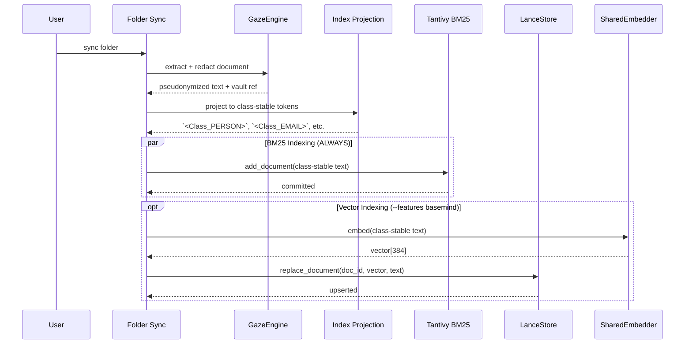
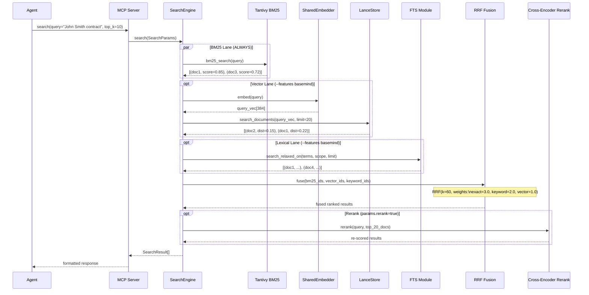
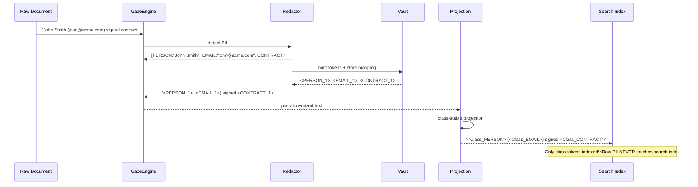

# Hacienda-Backend Architecture (Epic 14: Hybrid Search)

## System Overview

```mermaid
graph TB
    %% ============ USER / AGENT LAYER ============
    subgraph "Agent / User"
        Agent["🤖 AI Agent (Claude, etc.)"]
        CLI["💻 CLI User"]
    end

    %% ============ MCP INTERFACE ============
    subgraph "MCP Interface"
        MCPServer["🔌 MCP Server (stdio/HTTP)"]
        Tools["🛠️ MCP Tools\n- search\n- sync\n- rehydrate\n- doctor"]
    end

    %% ============ HACIENDA-BACKEND CORE ============
    subgraph "Hacienda-Backend Core"
        direction TB
        
        SearchEngine["🔍 SearchEngine"]
        BM25["📚 BM25 (Tantivy)\nALWAYS ON"]
        Vector["🧠 Vector Search\n(basemind LanceStore)"]
        Lexical["📝 Lexical Search\n(basemind FTS)"]
        RRF["⚖️ RRF Fusion\n(basemind or builtin)"]
        Rerank["🎯 Cross-Encoder Rerank\n(ort + bge-reranker-v2-m3)"]
        TierFilter["🛡️ Tier Filter\n(SensitivityTier)"]
        Projection["📋 Index Projection\n(Class-stable tokens)"]
        
        SearchEngine --> BM25
        SearchEngine -.->|feature=basemind| Vector
        SearchEngine -.->|feature=basemind| Lexical
        SearchEngine --> RRF
        SearchEngine --> Rerank
        SearchEngine --> TierFilter
        SearchEngine --> Projection
        
        BM25 --> RRF
        Vector --> RRF
        Lexical --> RRF
        RRF --> Rerank
        Rerank --> TierFilter
    end

    %% ============ GAZE (PII PSEUDONYMIZATION) ============
    subgraph "Gaze (PII Engine)"
        GazeEngine["🛡️ GazeEngine"]
        Redactor["🔒 Redactor"]
        Recognizers["🔍 Recognizers\n(Regex + NER + Dictionary)"]
        Assembly["⚙️ Assembly\n(Rulepacks)"]
        Vault["🗝️ Vault\n(Rehydration Map)"]
        
        GazeEngine --> Redactor
        Redactor --> Recognizers
        Recognizers --> Assembly
        Redactor --> Vault
    end

    %% ============ BASEMIND (AGENT CONTEXT) ============
    subgraph "Basemind (Agent Context Layer)"
        direction TB
        LanceStore["💾 LanceStore\n(LanceDB)"]
        DocumentsTable["📄 documents table"]
        MemoryTable["🧠 memory table"]
        FTS["🔤 FTS Module\n(search_relaxed_on)"]
        Embeddings["🧮 SharedEmbedder\n(bge-small-en-v1.5)"]
        RRFModule["⚖️ RRF Module\n(rrf_fuse_detailed)"]
        Reranker["🎯 Reranker\n(liter-llm + bge-reranker)"]
        
        LanceStore --> DocumentsTable
        LanceStore --> MemoryTable
        LanceStore --> FTS
        Embeddings --> LanceStore
        RRFModule --> LanceStore
        Reranker --> LanceStore
    end

    %% ============ XBERG (DOCUMENT INTELLIGENCE) ============
    subgraph "Xberg 1.3.10 (Patched)"
        XbergCore["📄 Xberg Core"]
        Extractors["📥 Extractors\n(PDF, Office, HTML, etc.)"]
        EmbeddingsX["🧮 Embeddings\n(ONNX Runtime)"]
        RerankX["🎯 Reranker\n(liter-llm)"]
        RedactionX["🔒 Redaction\n(rehydration)"]
        
        XbergCore --> Extractors
        XbergCore --> EmbeddingsX
        XbergCore --> RerankX
        XbergCore --> RedactionX
    end

    %% ============ STORAGE ============
    subgraph "Storage"
        TantivyIdx["📚 Tantivy Index\n(In-RAM BM25)"]
        LanceDB["💾 LanceDB\n(~/.local/share/hacienda/lance)"]
        VaultFile["🗝️ Vault Files\n(Encrypted)"]
        ConfigFile["⚙️ basemind.toml"]
    end

    %% ============ CONNECTIONS ============
    Agent --> MCPServer
    CLI --> MCPServer
    MCPServer --> Tools
    Tools --> SearchEngine
    Tools --> GazeEngine
    Tools --> LanceStore
    
    %% Indexing flow
    SearchEngine -->|index_document| BM25
    SearchEngine -.->|index_document| LanceStore
    GazeEngine -->|redact| SearchEngine
    
    %% Search flow
    SearchEngine -->|query| BM25
    SearchEngine -.->|query embedding| Embeddings
    Embeddings --> LanceStore
    SearchEngine -.->|lexical query| FTS
    FTS --> DocumentsTable
    
    %% Storage connections
    BM25 --> TantivyIdx
    LanceStore --> LanceDB
    Vault --> VaultFile
    SearchEngine --> ConfigFile
    
    %% Xberg integration
    XbergCore -.->|provides| Extractors
    XbergCore -.->|provides| EmbeddingsX
    XbergCore -.->|provides| RerankX
    Basemind -.->|uses| XbergCore
    
    %% Gaze integration
    GazeEngine -.->|uses| XbergCore
```



## Data Flow Diagrams

### 1. Document Ingestion Flow


### 2. Hybrid Search Flow


### 3. PII Protection Flow (Gaze Integration)


## Feature Matrix

| Feature | Default (BM25) | `--features basemind` |
|---------|----------------|----------------------|
| **BM25 Search** | ✅ Tantivy | ✅ Tantivy |
| **Vector Search** | ❌ | ✅ LanceStore KNN |
| **Lexical/FTS Search** | ❌ | ✅ LanceDB FTS + relaxation |
| **RRF Fusion** | ✅ Built-in | ✅ basemind RRF |
| **Cross-Encoder Rerank** | ⚠️ Stub | ⚠️ Stub (needs ort) |
| **Tier Filtering** | ✅ | ✅ |
| **PII Protection** | ✅ Gaze | ✅ Gaze |
| **Dependencies** | +2MB | +6MB (lancedb, arrow, xberg) |

## Build Configurations

```toml
# Cargo.toml features
[features]
default = ["bm25"]           # BM25 only (~20MB binary)
bm25 = []                    # Always available
basemind = ["dep:basemind", "dep:lancedb", "dep:arrow"]  # Hybrid (~26MB)
vector = ["basemind"]        # Alias

# Usage
cargo build                    # BM25 only
cargo build --features basemind  # Full hybrid
```

## Key Integration Points

| Component | Responsibility | Integration |
|-----------|---------------|-------------|
| **Gaze** | PII detection/redaction | Called before indexing; only class-stable tokens reach search |
| **Basemind** | Vector + Lexical storage | LanceStore for vectors, FTS for lexical, RRF for fusion |
| **Xberg** | Document extraction + embeddings | Patched 1.3.10 provides extractors, ONNX embeddings, reranker |
| **Tantivy** | BM25 lexical search | Pure Rust, no ML dependencies, always available |
| **LanceDB** | Columnar vector store | Stores documents + embeddings + FTS indexes |

## Fail-Closed Guarantees

1. **Default = BM25 only** - No ML models required, no network calls
2. **Class-stable tokens only** - Raw PII never enters search index
3. **Tier filtering** - `HardBlock` classes (API keys, secrets) never indexed
4. **One-way redaction option** - `one_way = ["password", "ssn"]` drops with `[REDACTED:<class>]`
5. **Reversible by default** - Vault map enables full rehydration

## Current Limitations / TODOs

- [ ] Cross-encoder rerank implementation (needs `ort` + `bge-reranker-v2-m3` ONNX model)
- [ ] FTS index rebuild strategy (currently per-document, should batch)
- [ ] Benchmark gate for hybrid search quality
- [ ] Streaming search for large result sets
- [ ] Multi-tenancy via `scope` isolation (partially implemented)